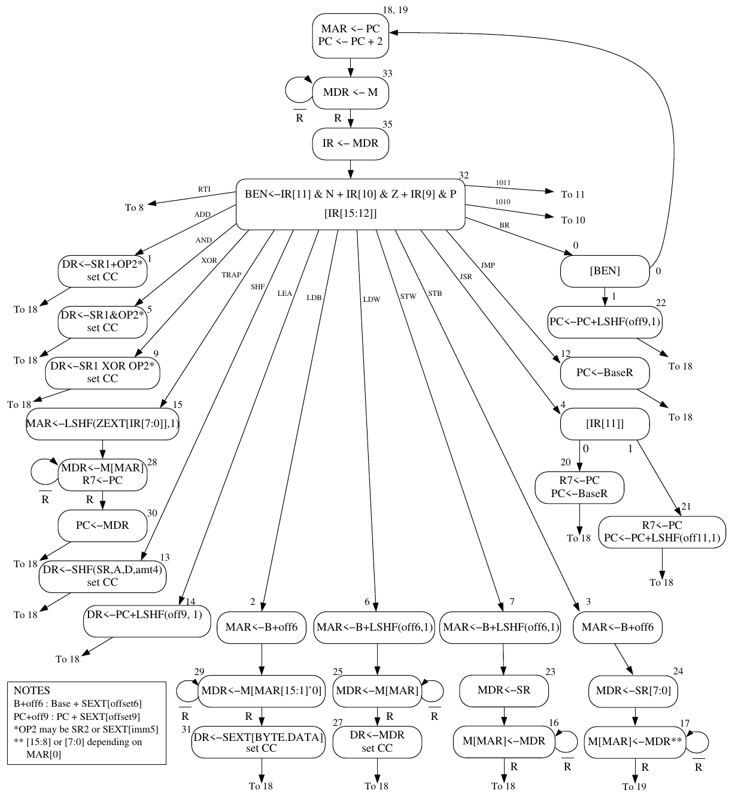
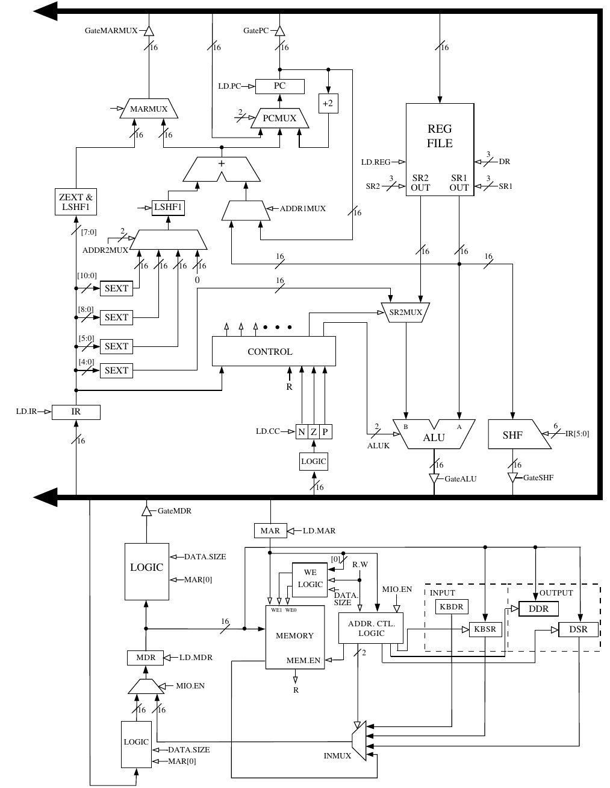
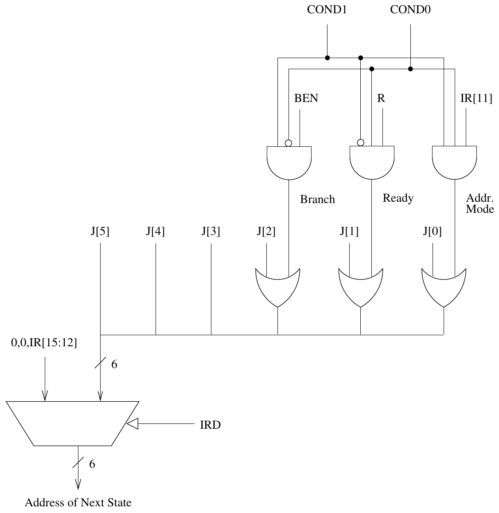

# Lab 3: LC-3b Microarchitecture Simulator

A cycle-level simulator in C for the LC-3b. Unlike Lab 2, each instruction is run as a sequence of microinstructions from a control store, simulating the microsequencer, datapath and memory clock cycle by clock cycle.

## Files

| File | Description |
|------|-------------|
| `lc3bsim3.c` | The simulator (my code starts after "Begin your code here") |
| `ucode3` | The control store: 64 states × 35 control bits |
| `assembler.linux` | Reference LC-3b assembler provided by the course |
| [`LC-3b_uarch.pdf`](LC-3b_uarch.pdf) | Appendix C: the full LC-3b microarchitecture reference |

## Building and running

```bash
gcc -std=c99 -o simulate lc3bsim3.c
./assembler.linux program.asm program.obj
./simulate ucode3 program.obj
```

## Shell commands

| Command | Description |
|---------|-------------|
| `go` | Run until `HALT` |
| `run <n>` | Run `n` cycles |
| `mdump <low> <high>` | Dump memory |
| `rdump` | Dump registers, IR, PC, MAR, MDR, bus and state |
| `?` | List commands |
| `quit` | Exit |

Dumps are written to a file named `dumpsim`.

## How it works

Each cycle runs these functions in order:

| Function | What it does |
|----------|--------------|
| `eval_micro_sequencer()` | Picks the next state and loads its microinstruction |
| `cycle_memory()` | Simulates memory. An access takes 5 cycles, and `R` is set after the 4th |
| `eval_bus_drivers()` | Computes the ALU, shifter, address adder, MARMUX and MDR outputs |
| `drive_bus()` | Puts the gated value on the bus, or 0 if nothing is gated |
| `latch_datapath_values()` | Loads the registers whose `LD.*` signal is set |

The diagrams below are from [Appendix C](LC-3b_uarch.pdf).

### State machine

Each state runs for one cycle. Fetch is states 18 → 33 → 35, decode is state 32, and the last state of each instruction goes back to 18.



### Datapath



### Datapath control signals

The first value of each signal is encoded as 0, the next as 1, and so on.

| Signal | Values |
|--------|--------|
| `LD.MAR`, `LD.MDR`, `LD.IR`, `LD.BEN`, `LD.REG`, `LD.CC`, `LD.PC` | NO, LOAD |
| `GatePC`, `GateMDR`, `GateALU`, `GateMARMUX`, `GateSHF` | NO, YES |
| `PCMUX` | PC+2, BUS, ADDER |
| `DRMUX` | IR[11:9], R7 |
| `SR1MUX` | IR[11:9], IR[8:6] |
| `ADDR1MUX` | PC, BaseR |
| `ADDR2MUX` | ZERO, offset6, PCoffset9, PCoffset11 |
| `MARMUX` | LSHF(ZEXT[IR[7:0]], 1), ADDER |
| `ALUK` | ADD, AND, XOR, PASSA |
| `MIO.EN` | NO, YES |
| `R.W` | RD, WR |
| `DATA.SIZE` | BYTE, WORD |
| `LSHF1` | NO, YES |

### Microsequencer

The microsequencer uses 9 bits of the microinstruction (`IRD`, `COND`, `J`) to pick the next state:

- If `IRD` is 1, the next state is `00` followed by `IR[15:12]`, which jumps to the first state for the opcode.
- Otherwise it is `J`, with one bit ORed in depending on `COND`:

| `COND` | Meaning | Bit set |
|--------|---------|---------|
| 0 | Unconditional | none |
| 1 | Memory ready (`R`) | `J[1]` |
| 2 | Branch (`BEN`) | `J[2]` |
| 3 | Addressing mode (`IR[11]`) | `J[0]` |



### Example

Input:

```asm
        .ORIG x3000
        AND R0, R0, #0
        ADD R0, R0, #5
        LEA R1, D
        LDW R2, R1, #0
        HALT
D       .FILL x1234
        .END
```

`go` then `rdump`:

```
Cycle Count  : 57
PC           : 0x0000
IR           : 0xf025
CCs: N = 0  Z = 0  P = 1
Registers:
0: 0x0005
1: 0x300a
2: 0x1234
...
7: 0x300a
```

### Limitations

- `RTI`, interrupts and exceptions aren't implemented.
- `TRAP` runs states 15, 28 and 30, but the trap vector table is all zeros, so the PC becomes 0 and the simulator halts.
- No memory-mapped I/O.
