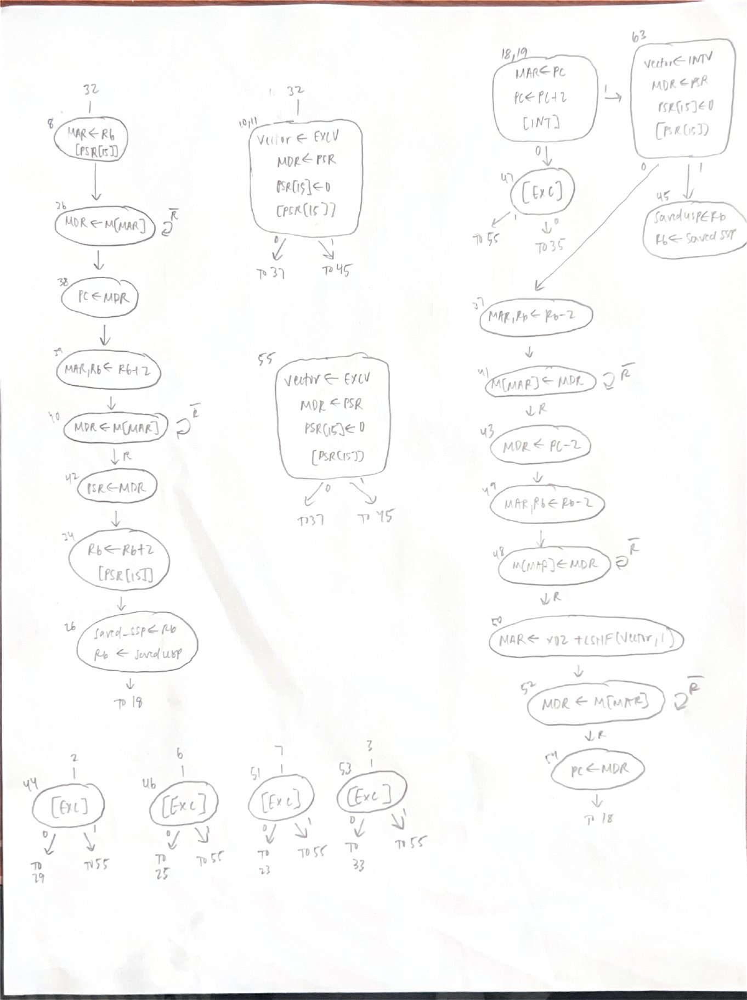
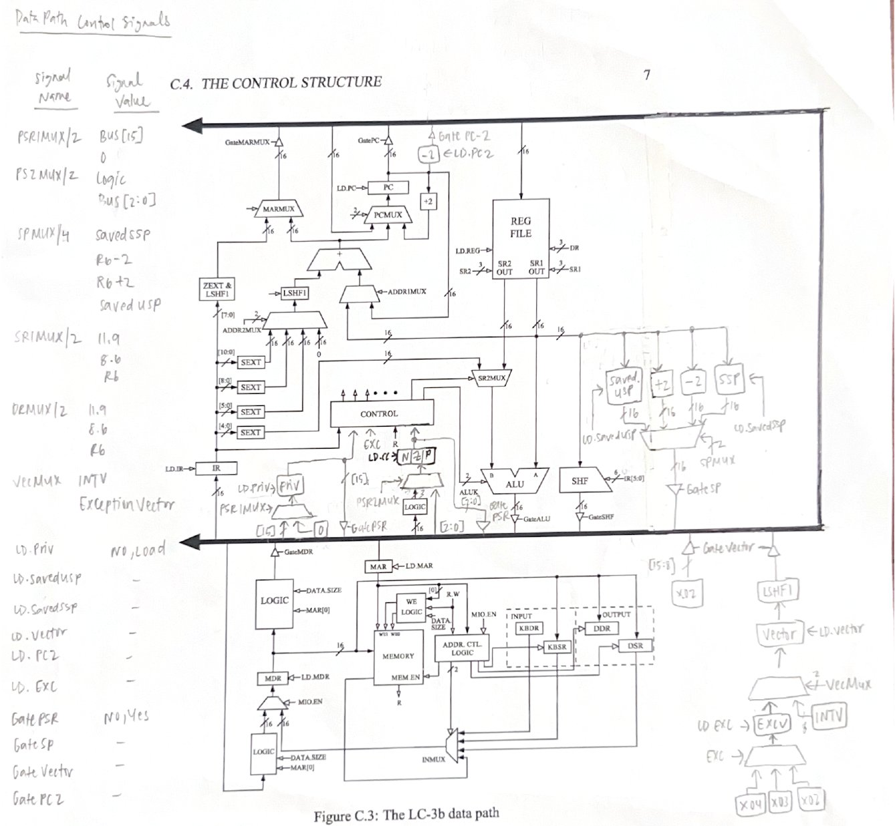
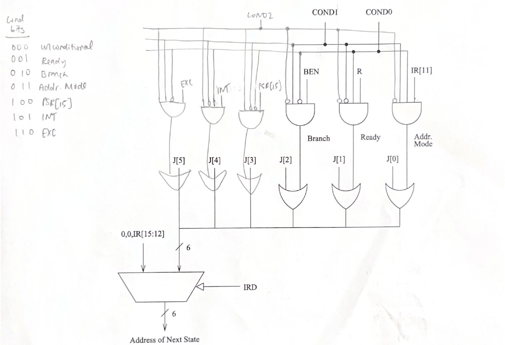

# Lab 4: Interrupts and Exceptions

Extends the Lab 3 cycle-level simulator to handle a timer interrupt, three exceptions (protection, unaligned access and unknown opcode), and the `RTI` instruction. This required new states, new datapath structures, new control signals and a bigger microsequencer.

## Files

| File | Description |
|------|-------------|
| `lc3bsim4.c` | The simulator |
| `ucode4` | The control store: 64 states × 53 control bits |
| `vector_table.asm` | Interrupt/exception vector table at x0200 |
| `int.asm` | Timer ISR at x1200: increments x4000 |
| `except_prot.asm` | Protection exception handler at x1600 |
| `except_unaligned.asm` | Unaligned access handler at x1A00 |
| `except_unknown.asm` | Unknown opcode handler at x1C00 |
| `add.asm` | User program at x3000: sums 20 bytes from xC000, then triggers an exception |
| `data.asm` | Data for the user program at xC000 |
| `assembler.linux` | Reference LC-3b assembler provided by the course |
| [`lab4_readme.pdf`](lab4_readme.pdf) | Design doc: state machine, datapath and microsequencer changes |

## Building and running

```bash
gcc -std=c99 -o simulate lc3bsim4.c
./assembler.linux program.asm program.obj    # repeat for each .asm file
./simulate ucode4 add.obj data.obj vector_table.obj int.obj except_prot.obj except_unaligned.obj except_unknown.obj
```

## How it works

| Event | Vector | Handler | Trigger |
|-------|--------|---------|---------|
| Timer interrupt | x01 | x1200 | Cycle 300 |
| Protection | x02 | x1600 | User mode accesses x0000–x2FFF |
| Unaligned access | x03 | x1A00 | Word access to an odd address |
| Unknown opcode | x04 | x1C00 | Opcode `1010` or `1011` |

When one of these is detected, the microcode:

1. Saves the PSR and switches to supervisor mode (`PSR[15] = 0`).
2. Switches R6 to the supervisor stack if it was in user mode.
3. Pushes the PSR and PC onto the supervisor stack.
4. Loads the PC from `x0200 + (vector << 1)`.

`RTI` reverses this: it pops the PC and PSR, then switches R6 back to the user stack if returning to user mode.

The diagrams below are from my [design doc](lab4_readme.pdf).

### State machine



| States | What happens |
|--------|--------------|
| 18, 19 | Fetch, now also checks for a pending interrupt |
| 63 | Interrupt entry: `Vector ← INTV`, `MDR ← PSR`, `PSR[15] ← 0` |
| 10, 11 | Unknown opcode entry: `Vector ← EXCV`, `MDR ← PSR`, `PSR[15] ← 0` |
| 55 | Protection/unaligned entry: same as above |
| 45 | Switch to the supervisor stack: `Saved_USP ← R6`, `R6 ← Saved_SSP` |
| 37, 41 | Push the PSR |
| 43, 49, 48 | Push PC − 2 |
| 50, 52, 54 | Load the handler address into the PC |
| 47, 44, 46, 51, 53 | Check for exceptions before each memory access |
| 8, 36, 38, 39, 40, 42, 34, 26 | `RTI`: pop the PC and PSR, then restore the user stack |

### Datapath



| Structure | Purpose |
|-----------|---------|
| `Priv` | 1-bit register holding `PSR[15]` |
| `Saved_USP`, `Saved_SSP` | Hold the inactive stack pointer |
| `SPMUX` | Selects `Saved_SSP`, R6 − 2, R6 + 2 or `Saved_USP` |
| PC − 2 | Return address saved on the stack |
| `EXCV`, `INTV`, `VECMUX`, `Vector` | Hold and select the vector |
| Vector adder | Computes `x0200 + (Vector << 1)` |
| EXC logic | Detects exceptions from `MAR`, `PSR[15]`, `DATA.SIZE` and the opcode |

### New control signals

| Signal | Values |
|--------|--------|
| `PSR1MUX` | BUS[15], 0 |
| `PSR2MUX` | Logic, BUS[2:0] |
| `SPMUX` | Saved_SSP, R6 − 2, R6 + 2, Saved_USP |
| `SR1MUX`, `DRMUX` | IR[11:9], IR[8:6], R6 |
| `VECMUX` | INTV, EXCV |
| `LD.Priv`, `LD.SavedUSP`, `LD.SavedSSP`, `LD.Vector`, `LD.PC2`, `LD.EXC` | NO, LOAD |
| `GatePSR`, `GateSP`, `GateVector`, `GatePC2` | NO, YES |

### Microsequencer

`COND` is now 3 bits wide, adding three conditions:

| `COND` | Meaning | Effect |
|--------|---------|--------|
| 000 | Unconditional | none |
| 001 | Memory ready (`R`) | Sets `J[1]` |
| 010 | Branch (`BEN`) | Sets `J[2]` |
| 011 | Addressing mode (`IR[11]`) | Sets `J[0]` |
| 100 | Privilege (`PSR[15]`) | Sets `J[3]` |
| 101 | Interrupt (`INT`) | Sets `J[4]` |
| 110 | Exception (`EXC`) | Jumps to state 55 |



### Example

`add.asm` sums the bytes at xC000, then stores to an odd address. The timer interrupt fires partway through, and the unaligned store traps to the handler.

| | Cycle | x4000 | PC | R6 |
|-|-------|-------|----|----|
| Before the interrupt | 299 | x0001 | x301A | xFE00 |
| After the halt | 1769 | x0002 | x0000 | x2FFC |

x4000 went from 1 to 2, so the ISR ran and returned. R6 is x2FFC because the exception pushed the PSR and PC onto the supervisor stack, which starts at x3000.
