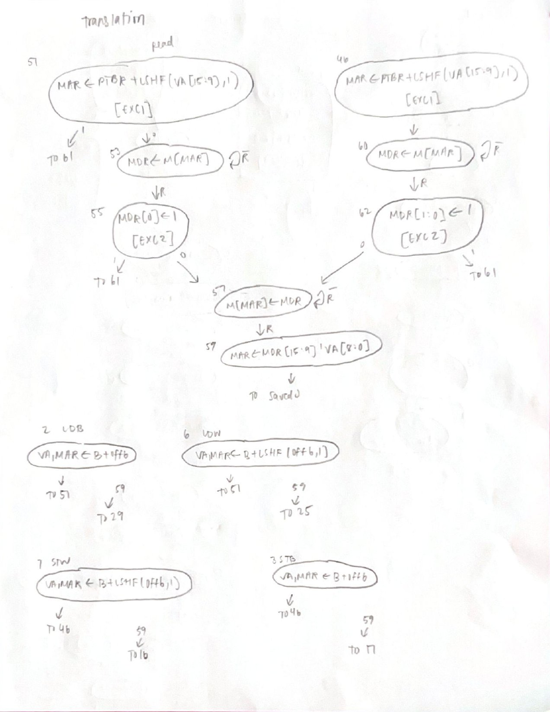
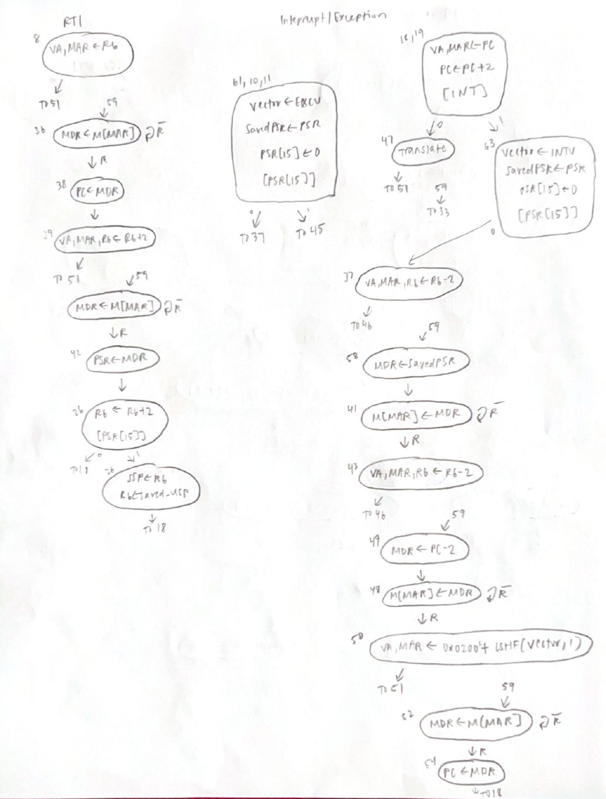
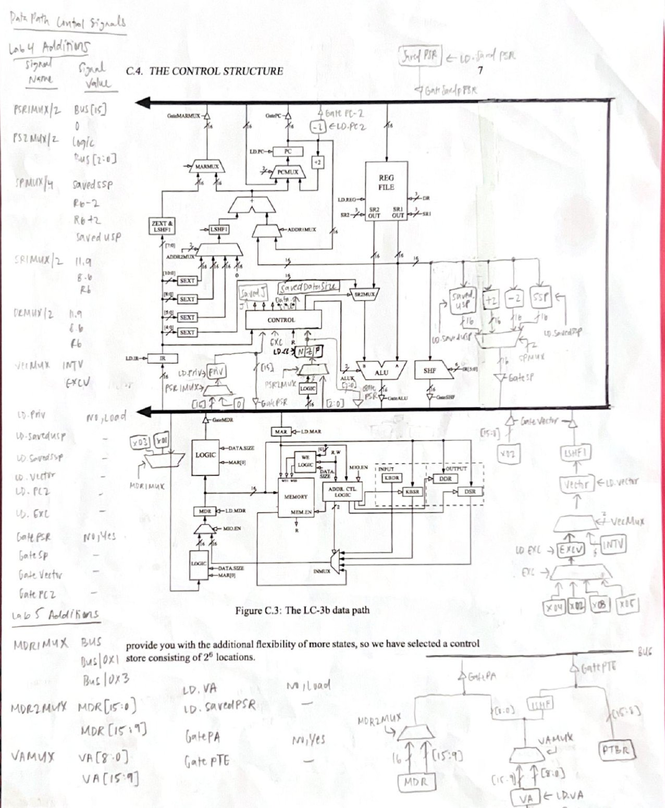
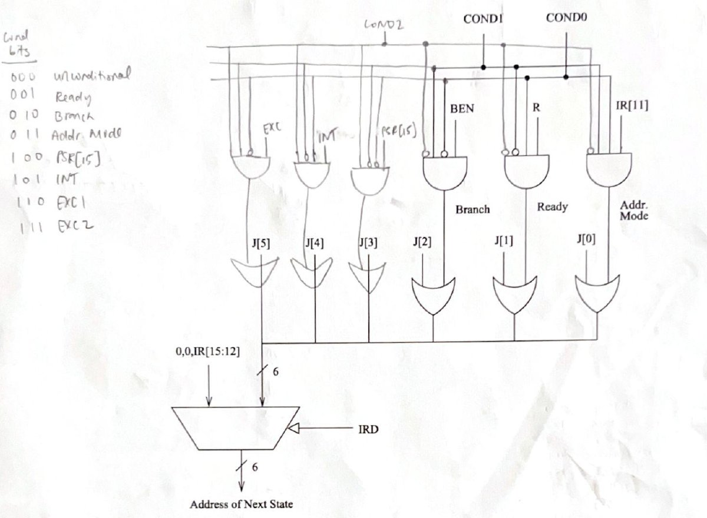

# Lab 5: Virtual Memory

Extends the Lab 4 simulator with virtual-to-physical address translation, a page fault exception, and protection based on the PTE instead of a fixed address range. All Lab 4 functionality (the timer interrupt, `RTI` and the other exceptions) still works.

## Files

| File | Description |
|------|-------------|
| `lc3bsim5.c` | The simulator |
| `ucode5` | The control store: 64 states × 64 control bits |
| `pagetable.asm` | Page table at physical address x1000 |
| `vector_table.asm` | Interrupt/exception vector table at x0200 |
| `int.asm` | Timer ISR at x1200: clears the reference bit of every PTE |
| `except_page.asm` | Page fault handler at x1400 |
| `except_prot.asm` | Protection handler at x1600 |
| `except_unaligned.asm` | Unaligned access handler at x1A00 |
| `except_unknown.asm` | Unknown opcode handler at x1C00 |
| `add.asm` | User program at x3000: sums 20 bytes from xC000, stores the sum at xC014, then jumps to it |
| `data.asm` | Data for the user program at xC000 |
| `assembler.linux` | Reference LC-3b assembler provided by the course |
| [`lab5_readme.pdf`](lab5_readme.pdf) | Design doc: state machine, datapath and microsequencer changes |

## Building and running

```bash
gcc -std=c99 -o simulate lc3bsim5.c
./assembler.linux program.asm program.obj    # repeat for each .asm file
./simulate ucode5 pagetable.obj add.obj data.obj vector_table.obj int.obj except_page.obj except_prot.obj except_unaligned.obj except_unknown.obj
```

The page table goes right after `ucode5`, and the other files can be in any order.

## How it works

### Virtual memory

- **Pages:** 512 bytes. There are 128 virtual pages and 32 physical frames.
- **System space:** pages 0–23, mapped directly to frames 0–23. These pages are protected.
- **User space:** pages 24–127. Pages 24, 96 and 126 are mapped to frames 25, 28 and 29, and the rest are invalid.
- **PTE format:** `PFN` in bits 13–9, then `P` (protected), `V` (valid), `M` (modified) and `R` (referenced) in bits 3–0.

Every memory access is translated:

1. Read the PTE at `PTBR + (page number << 1)`.
2. Check for protection and page fault exceptions.
3. Set the R bit, plus the M bit for a write, and write the PTE back.
4. Form the physical address: `PFN` followed by `VA[8:0]`.

### Exceptions

Listed from highest to lowest priority:

| Exception | Vector | Handler | Trigger |
|-----------|--------|---------|---------|
| Unaligned access | x03 | x1A00 | Word access to an odd virtual address |
| Protection | x04 | x1600 | User mode accesses a page with `P = 0`, except through `TRAP` |
| Page fault | x02 | x1400 | The page's `V` bit is 0 |
| Unknown opcode | x05 | x1C00 | Opcode `1010` or `1011` |

The timer interrupt (vector x01, handler x1200) still fires at cycle 300.

The diagrams below are from my [design doc](lab5_readme.pdf).

### State machine

#### Address translation



Any state that loads the MAR with a virtual address also loads the VA register and sets the `TRANSLATE` bit. This sends the microsequencer into the translation sequence. Reads start at state 51 and writes at state 46. State 59 sets `RFT` (return from translation), which jumps back to the state saved in `SavedJ`, and the original access then continues.

| States | What happens |
|--------|--------------|
| 51 (read), 46 (write) | `MAR ← PTBR + LSHF(VA[15:9], 1)`, then check for an unaligned access |
| 53, 60 | `MDR ← M[MAR]`: read the PTE |
| 55 (read) | Set R, then check for a protection or page fault |
| 62 (write) | Set M and R, then check for a protection or page fault |
| 57 | `M[MAR] ← MDR`: write the PTE back |
| 59 | `MAR ← PFN'VA[8:0]`, then return to `SavedJ` |
| 2, 3, 6, 7, 18, 19 | `LDB`, `STB`, `LDW`, `STW` and fetch now load VA as well as MAR, then translate |

#### Interrupts, exceptions and `RTI`



These sequences are the same as in Lab 4, except that every stack access goes through translation.

| States | What happens |
|--------|--------------|
| 61, 10, 11 | Exception entry: `Vector ← EXCV`, `SavedPSR ← PSR`, `PSR[15] ← 0` |
| 63 | Interrupt entry: `Vector ← INTV`, `SavedPSR ← PSR`, `PSR[15] ← 0` |
| 58 | `MDR ← SavedPSR`, since translation overwrote the MDR |
| 37, 43, 50 | Stack pushes and the vector table read now load VA and translate |
| 8, 39 | `RTI` stack pops now load VA and translate |

### Datapath



| Structure | Purpose |
|-----------|---------|
| `VA` | Holds the virtual address being translated |
| `PTBR` | Base address of the page table (x1000) |
| `SavedJ` | The state to return to after translation |
| `SavedDataSize` | `DATA.SIZE` of the pending access, used for the unaligned check |
| `SavedPSR` | Holds the PSR during interrupt/exception entry |
| `MDR1MUX` | Loads the MDR with BUS, BUS \| x1 (set R) or BUS \| x3 (set M and R) |
| `MDR2MUX`, `VAMUX` | Select the bits used for the PTE address and the physical address |
| PTE address logic | `PTBR[15:8]` followed by `LSHF(VA[15:9], 1)` |
| Physical address logic | `PFN` followed by `VA[8:0]` |
| EXC logic | Now 3 bits wide, with the page fault added |

### New control signals

| Signal | Values | Purpose |
|--------|--------|---------|
| `TRANSLATE` | NO, YES | Save the next state in `SavedJ` and start translating |
| `RFT` | NO, YES | Return from translation to `SavedJ` |
| `LD.VA` | NO, LOAD | Load VA |
| `LD.SavedPSR` | NO, LOAD | Load `SavedPSR` |
| `GateSavedPSR` | NO, YES | Put `SavedPSR` on the bus |
| `GatePTE` | NO, YES | Put the PTE address on the bus |
| `GatePA` | NO, YES | Put the physical address on the bus |
| `MDR1MUX` | BUS, BUS \| x1, BUS \| x3 | See the datapath table |
| `MDR2MUX` | MDR[15:0], MDR[15:9] | See the datapath table |
| `VAMUX` | VA[8:0], VA[15:9] | See the datapath table |

### Microsequencer



| `COND` | Meaning | Effect |
|--------|---------|--------|
| 000 | Unconditional | none |
| 001 | Memory ready (`R`) | Sets `J[1]` |
| 010 | Branch (`BEN`) | Sets `J[2]` |
| 011 | Addressing mode (`IR[11]`) | Sets `J[0]` |
| 100 | Privilege (`PSR[15]`) | Sets `J[3]` |
| 101 | Interrupt (`INT`) | Sets `J[4]` |
| 110 | Unaligned access (`EXC1`) | Jumps to state 61 |
| 111 | Protection or page fault (`EXC2`) | Jumps to state 61 |

When `TRANSLATE` is set, the next state is saved in `SavedJ` and the microsequencer jumps to state 51 for a read or 46 for a write. When `RFT` is set, the next state comes from `SavedJ`.

### Example

`add.asm` sums the 20 bytes, stores x0052 at virtual address xC014, then jumps to x0052. That address is in protected system space, so the jump causes a protection exception.

| | Value |
|-|-------|
| PTE for page 0 (x1000), before → after | x0004 → x0005 |
| Sum at physical x3814 (virtual xC014, page 96 → frame 28) | x0052 |
| PC after the halt | x0000 |
| R6 | x2FFC |
| R7 | x1602 |

- **R bit:** page 0's R bit is set at the end because the handler's `TRAP` read the trap vector table.
- **R6:** two words were pushed onto the supervisor stack.
- **R7:** the halt came from the protection handler at x1600.
