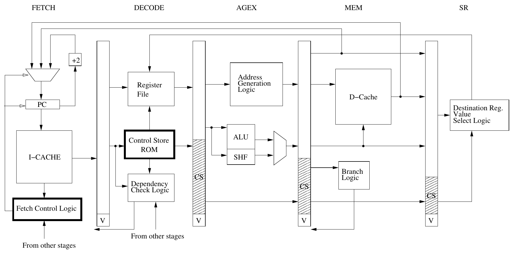
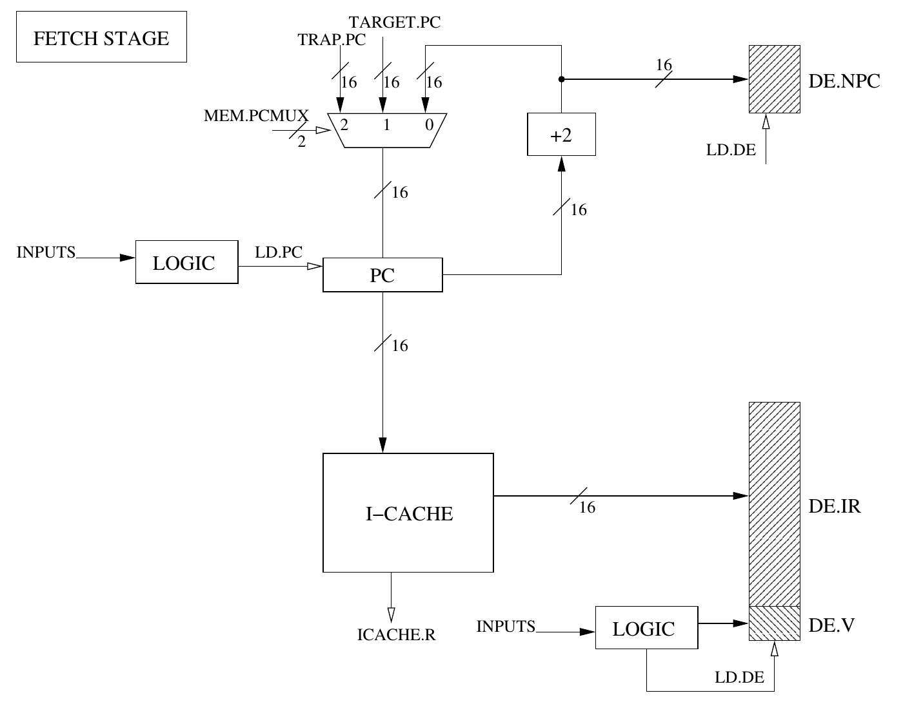
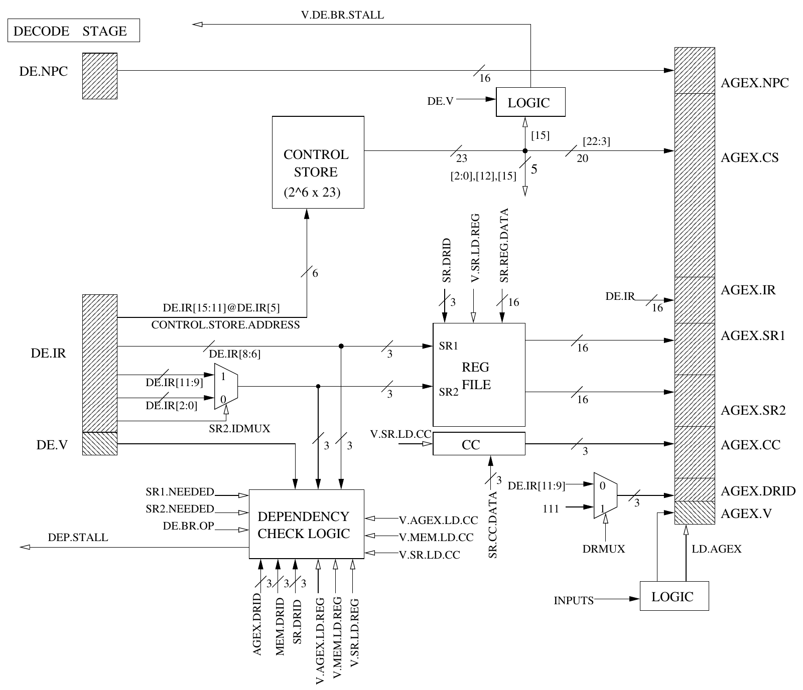
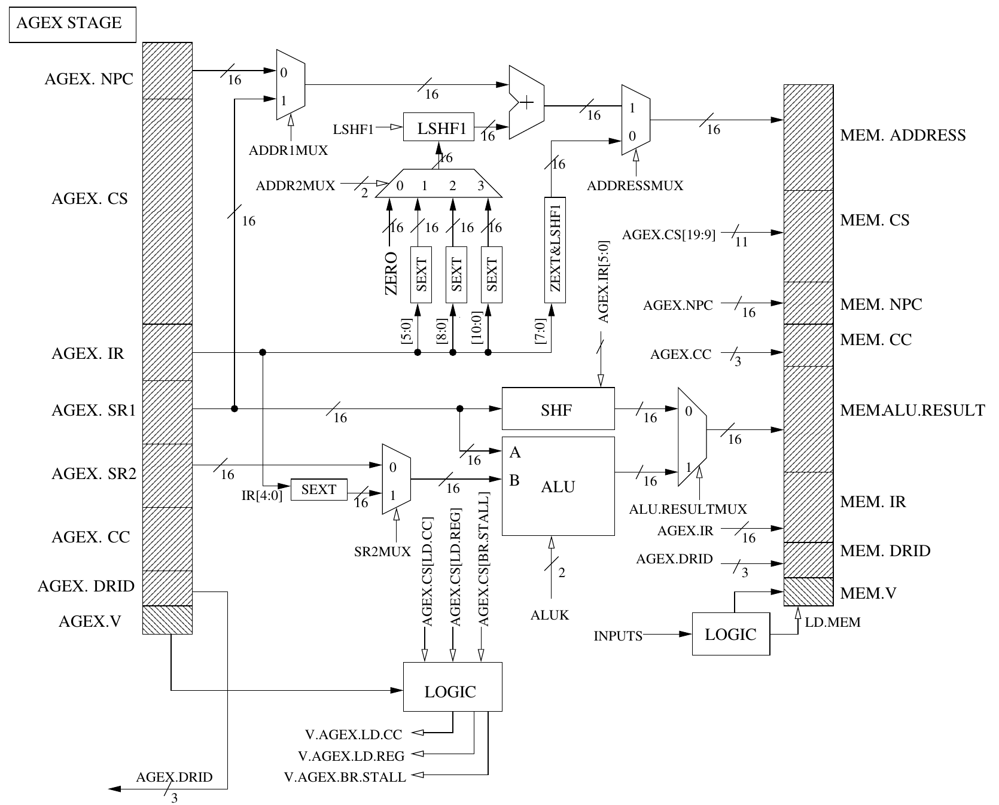
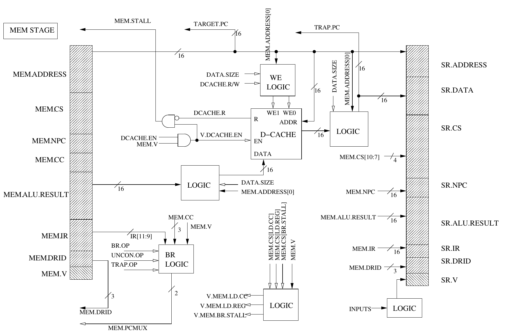
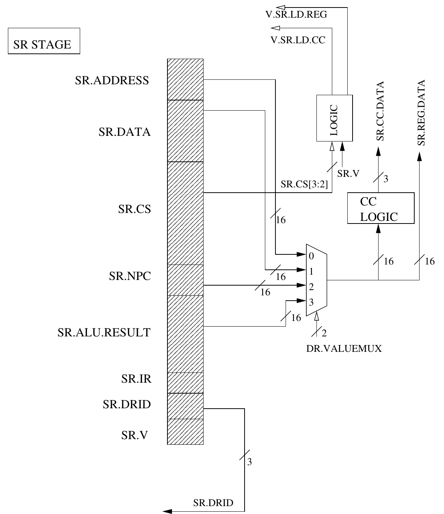

# Lab 6: Pipelined LC-3b

A simulator in C for a 5-stage pipelined LC-3b. Instructions overlap in the pipeline, data dependencies stall the decode stage (there's no forwarding), and control instructions stall fetch until they resolve in MEM.

## Files

| File | Description |
|------|-------------|
| `lc3bsim6.c` | The simulator (my code starts after "Begin your code here") |
| `ucode6` | The control store in the DE stage: 64 entries × 23 bits |
| `assembler.linux` | Reference LC-3b assembler provided by the course |
| [`lab6_documentation.pdf`](lab6_documentation.pdf) | Pipeline reference: stage diagrams and control signals |

## Building and running

```bash
gcc -std=c99 -o simulate lc3bsim6.c
./assembler.linux program.asm program.obj
./simulate ucode6 program.obj
```

## Shell commands

| Command | Description |
|---------|-------------|
| `go` | Run until `HALT` |
| `run <n>` | Run `n` cycles |
| `mdump <low> <high>` | Dump memory |
| `rdump` | Dump registers, PC and condition codes |
| `idump` | Same as `rdump`, plus every pipeline latch and stall signal |
| `?` | List commands |
| `quit` | Exit |

Dumps are written to a file named `dumpsim`.

## How it works

The diagrams below are from the [pipeline documentation](lab6_documentation.pdf).



| Stage | What happens |
|-------|--------------|
| Fetch (F) | Reads the I-cache at the PC and picks the next PC |
| Decode (DE) | Reads the control store and register file, and checks for dependencies |
| Address/Execute (AGEX) | Computes addresses and ALU/shifter results |
| Memory (MEM) | Accesses the D-cache and resolves branches |
| Store Result (SR) | Writes the register file and condition codes |

Each cycle, `cycle()` runs the stages from last to first (SR, MEM, AGEX, DE, F). Each stage reads the current latches (`PS`) and writes the next ones (`NEW_PS`).

### Stalls

| Signal | Set when | Effect |
|--------|----------|--------|
| `ICACHE.R` = 0 | The I-cache isn't ready | Fetch inserts a bubble |
| `DEP.STALL` | DE needs a register or condition codes that an older instruction hasn't written yet | DE holds, and a bubble goes into AGEX |
| `MEM.STALL` | A D-cache access isn't done | Everything before MEM holds, and a bubble goes into SR |
| `V.DE/AGEX/MEM.BR.STALL` | A valid control instruction is in that stage | Fetch inserts bubbles until it resolves in MEM |

### Fetch



- **PC update:** the PC is loaded with PC + 2, `TARGET.PC` or `TRAP.PC`, depending on `MEM.PCMUX`.
- **When it holds:** the PC holds during any stall, unless a branch resolving in MEM is redirecting it.
- **DE latches:** they load when there's no `DEP.STALL` or `MEM.STALL`.

### Decode



- **Control store address:** `IR[15:11]` followed by `IR[5]`.
- **Register file:** reads SR1 from `IR[8:6]`, and SR2 from `IR[11:9]` or `IR[2:0]` depending on `IR[13]`.
- **Dependency check:** compares the source registers against the destination register of each valid instruction in AGEX, MEM and SR. For branches, it also checks whether any of them write the condition codes.

### Address/Execute



- **Address adder:** the base (PC or SR1) plus an offset selected by `ADDR2MUX`, which can be shifted left by 1.
- **ALU and shifter:** results are selected by `ALU.RESULTMUX`.

### Memory



- **WE logic:** picks the write-enable bytes based on `DATA.SIZE` and `ADDRESS[0]`.
- **Byte loads:** the loaded byte is shifted and sign-extended.
- **BR logic:** sets `MEM.PCMUX`.
  - `BR` uses PC + 2 or `TARGET.PC`, depending on the condition codes and `IR[11:9]`.
  - `JMP`/`JSR` use `TARGET.PC`.
  - `TRAP` uses `TRAP.PC`.

### Store Result



`DR.VALUEMUX` picks what gets written: the address, the memory data, the NPC (for `JSR` and `TRAP`), or the ALU result.

### Control store signals

| Bit | Signal | Used in |
|-----|--------|---------|
| 0 | `SR1.NEEDED` | DE |
| 1 | `SR2.NEEDED` | DE |
| 2 | `DRMUX` | DE |
| 3 | `ADDR1MUX` | AGEX |
| 4–5 | `ADDR2MUX` | AGEX |
| 6 | `LSHF1` | AGEX |
| 7 | `ADDRESSMUX` | AGEX |
| 8 | `SR2MUX` | AGEX |
| 9–10 | `ALUK` | AGEX |
| 11 | `ALU.RESULTMUX` | AGEX |
| 12 | `BR.OP` | DE, MEM |
| 13 | `UNCON.OP` | MEM |
| 14 | `TRAP.OP` | MEM |
| 15 | `BR.STALL` | DE, AGEX, MEM |
| 16 | `DCACHE.EN` | MEM |
| 17 | `DCACHE.RW` | MEM |
| 18 | `DATA.SIZE` | MEM |
| 19–20 | `DR.VALUEMUX` | SR |
| 21 | `LD.REG` | AGEX, MEM, SR |
| 22 | `LD.CC` | AGEX, MEM, SR |

### Example

Input:

```asm
        .ORIG x3000
        AND R0, R0, #0
        ADD R0, R0, #5
        LEA R1, D
        LDW R2, R1, #0
        HALT
D       .FILL x1234
        .END
```

`go` then `rdump`:

```
Cycle Count : 16
CCs: N = 0  Z = 0  P = 1
Registers:
0: 0x0005
1: 0x300a
2: 0x1234
...
7: 0x300a
```

The registers match the Lab 3 microcoded simulator, which took 57 cycles for the same program.

### Limitations

- `RTI`, interrupts and exceptions aren't implemented.
- `TRAP` jumps to address 0, which halts the simulator.
